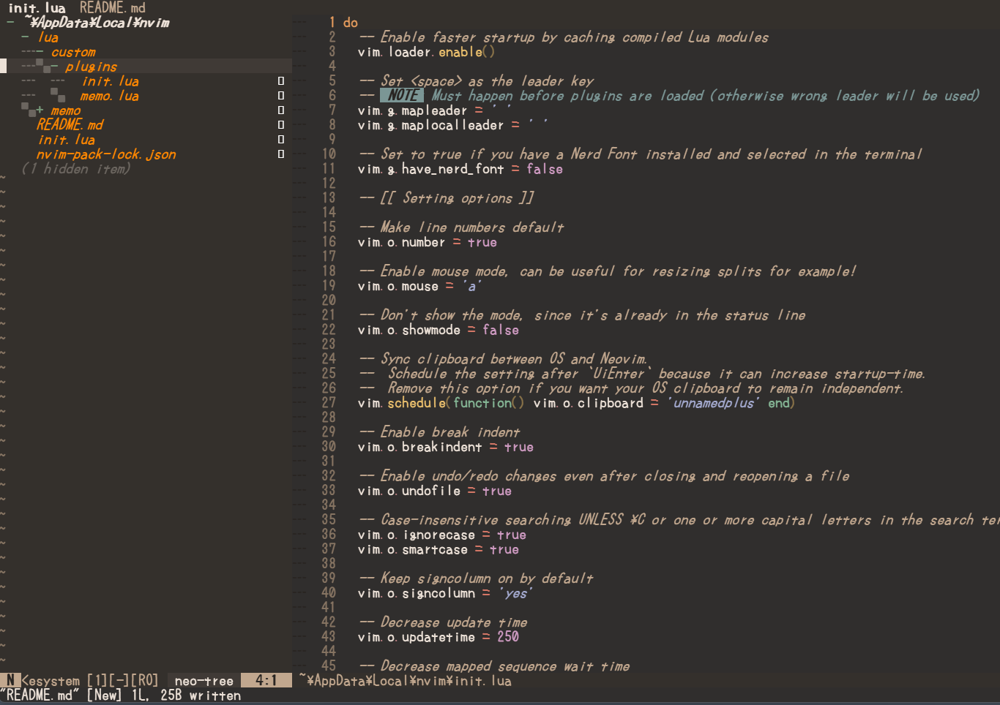
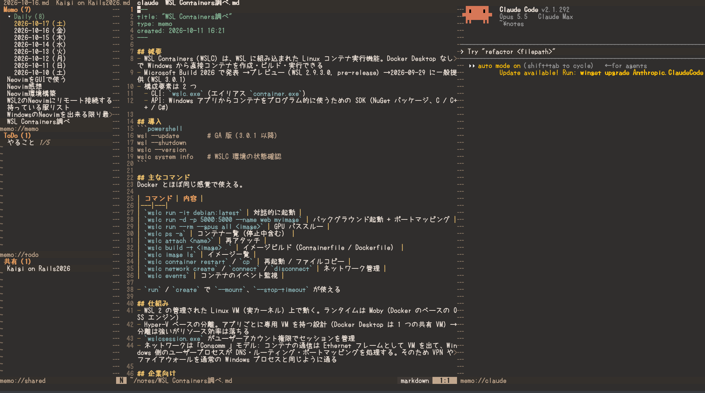

# My Neovim environment

Windows 向けの個人用 Neovim 設定です。[kickstart.nvim](https://github.com/nvim-lua/kickstart.nvim) をベースに、プラグイン管理を Neovim 組み込みの `vim.pack` に寄せ、自作のメモ / ToDo プラグイン（`lua/memo`）を足しています。



## 必要なもの

| | 用途 |
|---|---|
| Neovim 0.12 以上 | `vim.pack` を使うため必須 |
| git | プラグインの取得、メモの同期 |
| [ripgrep](https://github.com/BurntSushi/ripgrep) | Telescope の grep 検索 |
| [fd](https://github.com/sharkdp/fd) | `:Project` のフォルダ一覧 |
| PowerShell（`pwsh` があれば優先） | `:!` や `:terminal` のシェル |
| make（任意） | あれば `telescope-fzf-native.nvim` を入れてビルドする |
| [Claude Code](https://claude.com/claude-code)（任意） | `:MTClaude` |

winget でまとめて入れる場合:

```powershell
winget install --id Neovim.Neovim -e
winget install --id Git.Git -e
winget install --id BurntSushi.ripgrep.MSVC -e
winget install --id sharkdp.fd -e
winget install --id Microsoft.PowerShell -e   # pwsh
winget install --id ezwinports.make -e        # 任意
winget install --id Anthropic.ClaudeCode -e   # 任意
```

入れたあとはターミナルを開き直して PATH を反映させます。

## インストール

```powershell
git clone <このリポジトリの URL> "$env:LOCALAPPDATA\nvim"
nvim
```

初回起動時に `vim.pack` がプラグインを取得します。バージョンは `nvim-pack-lock.json` で固定されています。

```vim
:lua vim.pack.update()                          " プラグインを更新
:lua vim.pack.update(nil, { offline = true })   " 状態と保留中の更新を確認
```

### 自分の環境に合わせる箇所

パスを直接書いているところが 2 つあります。

- `init.lua` の `project_roots`（`:Project` / `<leader>p` が探すフォルダ。`{ '~', 'D:/work' }` のように複数書ける。`nil` か空ならホームディレクトリ）
- `lua/custom/plugins/memo.lua` の `dir`（メモの保存先。既定は `C:/Users/ywaka/notes`）

Nerd Font を使う場合は `init.lua` 冒頭の `vim.g.have_nerd_font` を `true` にします。

## 構成

```
init.lua                  設定本体（オプション、キーマップ、プラグイン）
nvim-pack-lock.json       プラグインのバージョン固定
lua/custom/plugins/       ここに置いた *.lua は起動時にすべて読み込まれる
  memo.lua                memo プラグインの setup
  claude.lua              :Claude（タブのルートで Claude Code）
lua/memo/                 自作のメモ / ToDo プラグイン
```

## プラグイン

| プラグイン | 役割 |
|---|---|
| [telescope.nvim](https://github.com/nvim-telescope/telescope.nvim)（+ ui-select, fzf-native） | ファジーファインダー |
| [neo-tree.nvim](https://github.com/nvim-neo-tree/neo-tree.nvim) | ファイルツリー |
| [blink.cmp](https://github.com/saghen/blink.cmp) + [LuaSnip](https://github.com/L3MON4D3/LuaSnip) | 補完とスニペット |
| [conform.nvim](https://github.com/stevearc/conform.nvim) | フォーマット |
| [gitsigns.nvim](https://github.com/lewis6991/gitsigns.nvim) | git の差分表示と hunk 操作 |
| [which-key.nvim](https://github.com/folke/which-key.nvim) | キーマップのヒント表示 |
| [mini.nvim](https://github.com/nvim-mini/mini.nvim) | ai / surround / statusline / tabline / bufremove |
| [scope.nvim](https://github.com/tiagovla/scope.nvim) | バッファ一覧をタブごとに分ける |
| [todo-comments.nvim](https://github.com/folke/todo-comments.nvim) | `TODO:` などのコメントを強調 |
| [guess-indent.nvim](https://github.com/NMAC427/guess-indent.nvim) | インデントの自動判定 |
| [melange-nvim](https://github.com/savq/melange-nvim) | カラースキーム |

LSP サーバーの設定は入っていません。フォーマッタも未登録で、`<leader>f` は LSP があればそのフォーマットを使います。

## キーマップ

リーダーキーは `<Space>` です。押すと which-key が候補を出します。

### 基本

| キー | 動作 |
|---|---|
| `<Esc>` | 検索ハイライトを消す |
| `<C-h>` `<C-j>` `<C-k>` `<C-l>` | ウィンドウ間の移動 |
| `<S-h>` / `<S-l>` | 前 / 次のバッファ |
| `<leader>bd` | バッファを閉じる（ウィンドウは残す） |
| `<leader>cd` | 開いているファイルのフォルダへ `cd` |
| `<leader>q` | 診断を location list に出す |
| `<leader>f` | バッファをフォーマット |
| `\\` | neo-tree を開いて現在のファイルを表示（ツリー内では閉じる） |
| `<Esc><Esc>` | ターミナルモードを抜ける |

`:terminal` は画面下に 15 行の分割で開きます。

neo-tree は「.」始まりのファイル・フォルダも表示します（`.git` だけは隠します。ツリー内で `H` を押すと隠したものも出せます）。

### 検索（Telescope）

| キー | 動作 |
|---|---|
| `<leader>sf` | ファイル |
| `<leader>sg` | grep |
| `<leader>sw` | カーソル下の単語 |
| `<leader>s.` | 最近開いたファイル |
| `<leader><leader>` | バッファ |
| `<leader>/` | 現在のバッファ内 |
| `<leader>s/` | 開いているファイルを grep |
| `<leader>sp` | プロジェクト |
| `<leader>sn` | Neovim の設定ファイル |
| `<leader>sh` / `sk` / `sc` | ヘルプ / キーマップ / コマンド |
| `<leader>sd` | 診断 |
| `<leader>sr` | 直前の検索を再開 |
| `<leader>ss` | Telescope のピッカー一覧 |

### Git（gitsigns）

| キー | 動作 |
|---|---|
| `]c` / `[c` | 次 / 前の変更へ |
| `<leader>hs` / `hr` | hunk を stage / reset（ビジュアルモードでは選択範囲） |
| `<leader>hS` / `hR` | バッファ全体を stage / reset |
| `<leader>hp` / `hi` | hunk をプレビュー / インライン表示 |
| `<leader>hb` | 行の blame |
| `<leader>hd` / `hD` | index / 直前のコミットと diff |
| `<leader>hq` / `hQ` | hunk を quickfix へ（ファイル / リポジトリ全体） |
| `<leader>tb` / `tw` | 行 blame / 単語 diff の表示切り替え |
| `ih` | hunk のテキストオブジェクト |

### 補完（blink.cmp）

`default` プリセットです。補完メニューは入力中に自動で出ます。出ていないときは `<C-space>` で開始します。

| キー | 動作 |
|---|---|
| `<C-space>` | 補完を開始（メニューが出ているときはドキュメントの表示 / 非表示） |
| `<C-n>` / `<C-p>`、`<Down>` / `<Up>` | 次 / 前の候補 |
| `<C-y>` | 確定 |
| `<C-e>` | メニューを閉じる |
| `<C-k>` | シグネチャ表示の切り替え |
| `<Tab>` / `<S-Tab>` | スニペットの次 / 前の入力位置へ |

コマンドラインでは `<Tab>` で補完を開始し、メニューが出ていれば選択中の候補を確定します。

## プロジェクト

タブ 1 つを 1 プロジェクトとして使います。scope.nvim によりバッファ一覧はタブごとに分かれます。ターミナル（`:terminal`、`:Claude`、`:MTClaude`）などファイル以外のバッファはタブラインやバッファ一覧に出しません。

- `:Project` / `<leader>p` / `<leader>sp` … `project_roots`（既定はホームディレクトリ）以下 2 階層のフォルダから選び、新しいタブで開いて `:tcd` し、neo-tree も開く
- `:Project <path>` … 指定したフォルダを同じように開く

タブの移動と削除は Neovim 標準の操作を使います（専用のキーマップは設定していません）。

| キー / コマンド | 動作 |
|---|---|
| `gt` / `gT` | 次 / 前のタブへ |
| `{番号}gt` | 指定した番号のタブへ（`2gt` で 2 番目） |
| `g<Tab>` | 直前にいたタブへ |
| `:tabclose` | 現在のタブを閉じる |
| `:tabonly` | 現在のタブ以外をすべて閉じる |

タブを閉じても、そのタブで開いていたバッファは残ります。`<S-h>` / `<S-l>` はタブ内のバッファの移動です。

### Claude Code（`:Claude`）

`lua/custom/plugins/claude.lua`。タブのルートフォルダで [Claude Code](https://claude.com/claude-code) を右側のターミナルに開きます。セッションはタブごとに 1 つです。

- ルートは、`:WslOpen` で開いたタブならその WSL のフォルダ（WSL 側で `bash -lic 'exec claude'` を起動）、それ以外はタブのカレントディレクトリ（`:tcd` / `:Project` で設定したもの。なければ全体のカレントディレクトリ）
- ウィンドウを隠してもセッションは続き、もう一度 `:Claude` で戻れます。タブを閉じるとそのタブのセッションも終了します
- ルートはセッションを起動した時点のものです。途中で `:tcd` しても、起動中のセッションはそのまま使われます

| キー / コマンド | 動作 |
|---|---|
| `:Claude` | 開く / 隠す |
| `:Claude {文章}` | 文章を送る（起動していなければ、それを最初の指示にして起動） |
| `<C-q>` / `q`（ノーマルモード） | 隠す |
| `<Esc>` | そのまま Claude に渡す（`<Esc><Esc>` でターミナルモードを抜けられないので `<C-\><C-n>` を使う） |

## メモ / ToDo（`lua/memo`）

1 つのフォルダに Markdown を平置きするメモプラグインです。メモと ToDo は frontmatter の `type` で区別します。



```markdown
---
title: "引っ越し"
type: todo
created: 2026-10-12 09:00
---

- [ ] 電気の手続き
- [x] ガスの手続き
```

ファイル名はタイトルと同じです。`title` を書き換えて保存するとファイル名も変わり、他のメモからのリンクも書き換わります。タイトルが日付（`%Y-%m-%d`）のメモはデイリーメモとして扱われます。

### コマンド

| コマンド | 動作 |
|---|---|
| `:Memo` / `:Todo` | 一覧（Telescope） |
| `:Memo n [タイトル]` / `:Todo n [タイトル]` | 新規作成。同名があればそれを開く |
| `:Memo d` | 今日のデイリーメモを開く / 作る |
| `:Memo g` | メモ本文を行単位で絞り込み |
| `:Todo g` | 未完了の項目を横断して絞り込み |
| `:Memo l` / `:Todo l` | リンクを挿入 |
| `:Memo b` / `:Todo b` | 開いているメモへのバックリンク |
| `:Memo s` / `:Todo s` | 開いているメモを共有に移す / 個人に戻す |
| `:MT` | 左側の一覧ペインを開閉 |
| `:MTSync` | git リモートと同期（共有のリポジトリも） |
| `:MTSync init <URL>` | メモのフォルダをリポジトリにしてリモートへつなぐ |
| `:MTSync init-shared <URL>` | 共有フォルダ（`shared/`）をリポジトリにしてリモートへつなぐ |
| `:MTClaude [文章]` | メモのフォルダで Claude Code を開閉。文章を付けるとそれを送る |

### キー

| 場所 | キー | 動作 |
|---|---|---|
| メモのバッファ | `<leader>x` | チェックボックスの切り替え（ビジュアルモードでは選択行） |
| | `<CR>` | カーソル下のリンクを開く |
| | `[[`（挿入モード） | リンク先を選んで挿入 |
| 一覧ペイン（`:MT`） | `<CR>` / `o` | 開く |
| | `n` | 新規作成（Daily の上では今日のメモ） |
| | `d` | 削除 |
| | `s` | 共有に移す（共有の段では個人に戻す） |
| | `t`（共有の段） | 共有 ToDo を作る |
| | `<Tab>` | 次の段へ |
| | `R` / `q` | 再読み込み / 閉じる |
| Telescope の一覧 | `g`（挿入モードは `<C-g>`） | 本文 / 項目の絞り込みへ |
| | `d` | 削除 |
| | `x` | 項目を完了にする（`:Todo g`） |
| | `/` | 絞り込み入力へ戻る |
| Claude のウィンドウ | `<C-q>` / `q` | 隠す（セッションは続く） |

### リンク

`[[タイトル]]`、`[[タイトル#見出し]]`、`[[タイトル|表示名]]` の形式です。まだないメモへのリンクを開くと、その場で作成されます。Markdown のリンクと URL も `<CR>` で開けます。

### git 同期

メモのフォルダが git リポジトリのときだけ動きます。

- 保存の 10 秒後に commit → `pull --rebase` → push
- セッションで最初に `:Memo` / `:Todo` / `:MT` を使ったときに pull
- Neovim の終了時に未送信の変更を push

競合したら rebase を取り消して自動同期を止めます。手元の内容はそのまま残るので、ターミナルで解決してから `:MTSync` を実行してください。`sync.conflict = 'copy'` にすると、止めずに相手の版を採用し、自分の版を別のメモに残します（[共有](#共有) と同じ動き）。

#### リポジトリの設定

1. git の名前とメールアドレスを設定する（未設定だと commit できません）。

   ```powershell
   git config --global user.name "名前"
   git config --global user.email "you@example.com"
   ```

2. GitHub などに空のリポジトリを作る（メモを公開しないなら private にする）。

3. そのリポジトリへ、パスワードなどを聞かれずに push できるようにしておく。同期は裏で動くため、認証の入力を求められるとそのまま失敗します。HTTPS なら Git Credential Manager（Git for Windows に同梱）、SSH なら鍵を登録しておきます。

4. Neovim で次を実行する。

   ```vim
   :MTSync init https://github.com/<ユーザー名>/<リポジトリ名>.git
   ```

   メモのフォルダを git リポジトリにして（ブランチは `main`）、`origin` を設定し、今あるメモを commit して push します。リモートに既に中身があれば、先にそれを取り込みます。

「同期しました」と通知が出れば完了で、以降は自動で同期されます。失敗したときは通知に理由が出ます。

2 台目以降の PC でも、`dir` を設定してから同じ `:MTSync init <URL>` を実行すれば、リモートのメモが取り込まれます。先に `git clone <URL> <dir>` しておいても構いません。

リモートを使わず履歴だけ残したい場合は、メモのフォルダで `git init` するだけで、保存のたびに commit されます。

### 共有

家族やチームとメモ / ToDo を共有できます。メモのフォルダの中の `shared/` を個人とは別の git リポジトリにして、共有する人全員でそのリポジトリを同期します。`shared/` の外にある個人のメモは共有されません。

```
notes/                  個人のリポジトリ（:MTSync init）
  .gitignore            shared/ を個人のリポジトリから外す（自動で追記）
  買い物.md
  shared/               共有のリポジトリ（:MTSync init-shared）
    旅行の計画.md
    家の用事.md
```

#### 始め方

1. GitHub などに共有用の空のリポジトリを private で作り、共有する人を collaborator に招待する（全員が push できるようにする）。
2. 各自が git の名前とメールアドレスを設定し、パスワードなどを聞かれずに push できるようにしておく（[リポジトリの設定](#リポジトリの設定) の 1 と 3 と同じ）。
3. 各自の Neovim で次を実行する。

   ```vim
   :MTSync init-shared https://github.com/<ユーザー名>/<共有リポジトリ名>.git
   ```

   最初の人の `shared/` の中身が push され、2 人目以降はそれが取り込まれます。個人のリポジトリ（`:MTSync init`）を設定していなくても使えます。

ほかの人がこの設定を使っていなくても、同じ書式の Markdown をリポジトリに push すれば一覧に出ます。

#### 使い方

- 一覧ペイン（`:MT`）の「共有」の段に、共有のメモと ToDo が更新順に並びます。`n` で共有メモ、`t` で共有 ToDo を作ります。
- 個人のメモを共有するには、一覧ペインで `s` を押すか、メモを開いて `:Memo s`（`:Todo s`）を実行します。共有のメモで同じ操作をすると個人に戻ります。個人に戻すと、ほかの人の手元からは消えます。
- `:Memo` / `:Todo` の一覧やリンクの候補にも出て、タイトルの後ろに `［共有］` が付きます。
- 共有のメモにある `[[リンク]]` は、共有のメモを先に探します。まだないメモへのリンクを開くと、共有に作ります。共有のメモから個人のメモへリンクしても、ほかの人は開けません。
- 共有のメモを削除すると、全員の手元から消えます。

#### 同期

個人のリポジトリと同じ仕組み（commit → `pull --rebase` → push）で、次のときに動きます。

- 保存の 5 秒後
- 2 分おき（ほかの人の変更を取り込むため）
- Neovim に戻ってきたとき（前回の同期から 30 秒以上たっていれば）
- セッションで最初に `:Memo` / `:Todo` / `:MT` を使ったとき、Neovim の終了時、`:MTSync` を実行したとき

ほかの人の変更を取り込むと「リモートの変更を取り込みました」と通知が出ます。

同じメモを同時に編集して競合したときは、同期を止めずに相手の版を採用し、自分の版を「タイトル (競合 月-日 時:分)」という別のメモとして残します。見比べて必要なら手で直し、競合のメモは消してください。この動きは `conflict` で変えられます（個人のリポジトリは既定で同期を止めます）。

#### 設定

`setup` の `shared` に渡します。

| 項目 | 既定値 | 内容 |
|---|---|---|
| `enabled` | `true` | `false` にすると共有を使わない（「共有」の段も出ない） |
| `dir` | `'shared'` | メモのフォルダの中の共有フォルダ名 |
| `label` | `'共有'` | 一覧ペインの見出し |
| `sync.auto` | `true` | 保存したら自動で同期する |
| `sync.delay` | `5` | 最後の変更から何秒待って同期するか |
| `sync.poll` | `120` | 何秒おきにほかの人の変更を取り込むか（`0` で無効） |
| `sync.notify_pull` | `true` | ほかの人の変更を取り込んだら通知する |
| `sync.commit_message` | `'shared: %Y-%m-%d %H:%M'` | commit のメッセージ（`os.date` の形式） |
| `sync.conflict` | `'copy'` | `'copy'`: 相手の版を採用し自分の版を別のメモに残す / `'stop'`: 自動同期を止める |

一覧ペインで「共有」の段を出す位置は `sidebar.sections`（既定は `{ 'memo', 'todo', 'shared' }`）で変えられます。

### Claude 連携

`:MTClaude` は、メモのフォルダを作業フォルダにして [Claude Code](https://claude.com/claude-code) を Neovim のターミナルで開きます。メモを書かせたり、メモの内容について質問したりできます。`claude` コマンドが使える状態にしておいてください。

```vim
:MTClaude                              " 開く / 隠す
:MTClaude 今週のデイリーメモを要約して   " 文章を送る（起動していなければ起動する）
```

- ウィンドウを隠してもセッションは続きます。もう一度 `:MTClaude` で戻れます。Claude Code を終了するとウィンドウも閉じます。
- 起動時に、メモの書式ルール（frontmatter の形式、ファイル名、`[[リンク]]` の書き方、git を操作しないことなど）を追加のシステムプロンプトとして渡します。Claude が作るメモは、そのまま一覧やリンクで扱えます。
- Claude がファイルを書き換えると、開いているバッファと一覧ペインに反映され、git 同期も予約されます。
- 共有フォルダのことも伝えてあります。「共有に」「家族と」のように頼んだときだけ `shared/` にメモを作ったり移したりし、質問には共有のメモも検索して答えます。
- メモのフォルダに `CLAUDE.md` を置けば、自分用のルールを足せます。`CLAUDE.md` / `AGENTS.md` / `README.md` はメモの一覧に出ません。

#### キー

| キー | 動作 |
|---|---|
| `<C-q>` | ウィンドウを隠す |
| `q`（ノーマルモード） | ウィンドウを隠す |
| `<Esc>` | そのまま Claude に渡す（中断。2 回で巻き戻し） |
| `<C-\><C-n>` | ターミナルモードを抜ける |

`<Esc>` を Claude に渡すため、このウィンドウでは `<Esc><Esc>` でターミナルモードを抜けられません。`<C-\><C-n>` を使います。

#### 表示

既定の `renderer = 'classic'` では、会話が Neovim のターミナルの履歴に流れるので、ノーマルモードでスクロール、`/` 検索、コピーができます。`'fullscreen'` にすると Claude Code 標準のフルスクリーン表示になり、スクロールは `PgUp` / `PgDn` です。

#### 設定

`setup` の `claude` に渡します。

| 項目 | 既定値 | 内容 |
|---|---|---|
| `cmd` | `'claude'` | 実行ファイル。`{ 'claude', '--model', 'sonnet' }` のようなリストも可 |
| `args` | `{}` | 追加の引数（例: `{ '--permission-mode', 'acceptEdits' }`） |
| `continue` | `false` | `true` なら前回の会話の続きから始める |
| `layout` | `'right'` | `'right'` / `'bottom'` / `'float'` |
| `size` | `0.4` | right / bottom のときの幅・高さ（画面に対する割合） |
| `float_size` | `0.8` | float のときの大きさ |
| `renderer` | `'classic'` | `'classic'` / `'fullscreen'` |
| `scrollback` | `100000` | 遡れる行数 |
| `keys.hide` | `'<C-q>'` | ウィンドウを隠すキー |
| `keys.pass_esc` | `true` | `<Esc>` をそのまま Claude に渡す |

### 設定

`lua/custom/plugins/memo.lua` の `setup` に渡します。指定できる項目と既定値は `lua/memo/config.lua` にあります。

```lua
require('memo').setup {
  dir = '~/notes',
  sync = { delay = 30 },
  shared = { sync = { poll = 60 } },
  claude = { layout = 'float' },
  sidebar = { sections = { 'memo', 'daily', 'todo' } },
}
```
